<div align="center">
  <h1>MMDX12</h1>
  <p><a href="README.md">English</a> · <b>한국어</b> · <a href="README.ja.md">日本語</a> · <a href="README.zh.md">简体中文</a></p>
  <p>갖고 있는 MMD 모델이랑 춤 파일 넣고 재생만 누르면 레이 트레이싱 조명으로 바로 볼 수 있어요.<br>더 예쁘게 뽑고 싶으면 앱 안에서 4K 사진이나 뮤직비디오 한 편까지 렌더링됩니다.</p>
  <p>
    
    
    <a href="LICENSE"></a>
    <a href="https://youtu.be/7S7D670HbIM"></a>
    <a href="#후원"></a>
  </p>
  <a href="https://youtu.be/7S7D670HbIM">
    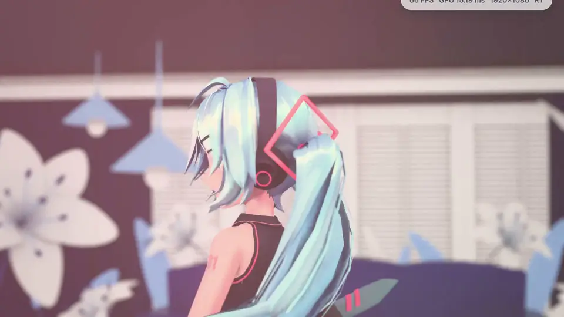
  </a>
  <br>
  ▶ YouTube: <a href="https://youtu.be/7S7D670HbIM">전체 소개 영상</a>
  <p>
    <a href="#갤러리">갤러리</a> ·
    <a href="#할-수-있는-것">할 수 있는 것</a> ·
    <a href="#시작하기">시작하기</a> ·
    <a href="#스튜디오">스튜디오</a> ·
    <a href="#벤치마크">벤치마크</a> ·
    <a href="#mcp-제어">MCP 제어</a>
  </p>
</div>

## 갤러리


<br><sub>같은 프레임을 네 가지로: MMD 기본 느낌, MMDX12 래스터(기본값, DX12 GPU면 모두), 실시간 레이 트레이싱, 실시간 패스 트레이싱</sub>

내장 렌더러로 뽑은 그대로예요. 보정 안 했습니다.

<table>
  <tr>
    <td>
      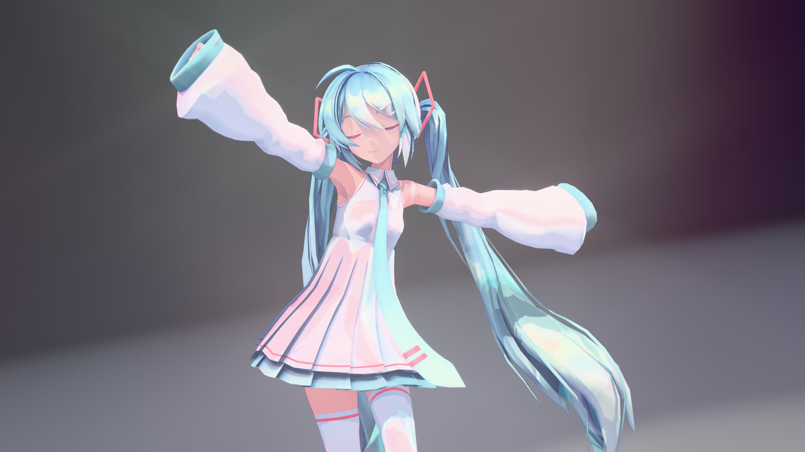
      <br><i>부드러운 스튜디오 조명</i>
    </td>
    <td>
      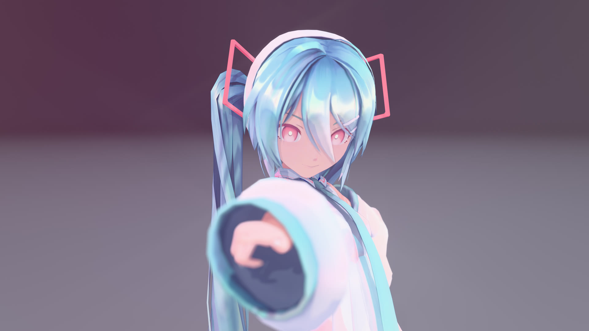
      <br><i>앞쪽이 흐릿하게 날아간 클로즈업</i>
    </td>
  </tr>
  <tr>
    <td>
      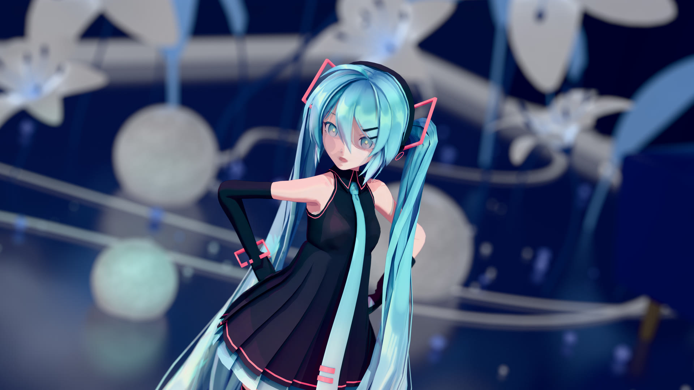
      <br><i>밤 무대</i>
    </td>
    <td>
      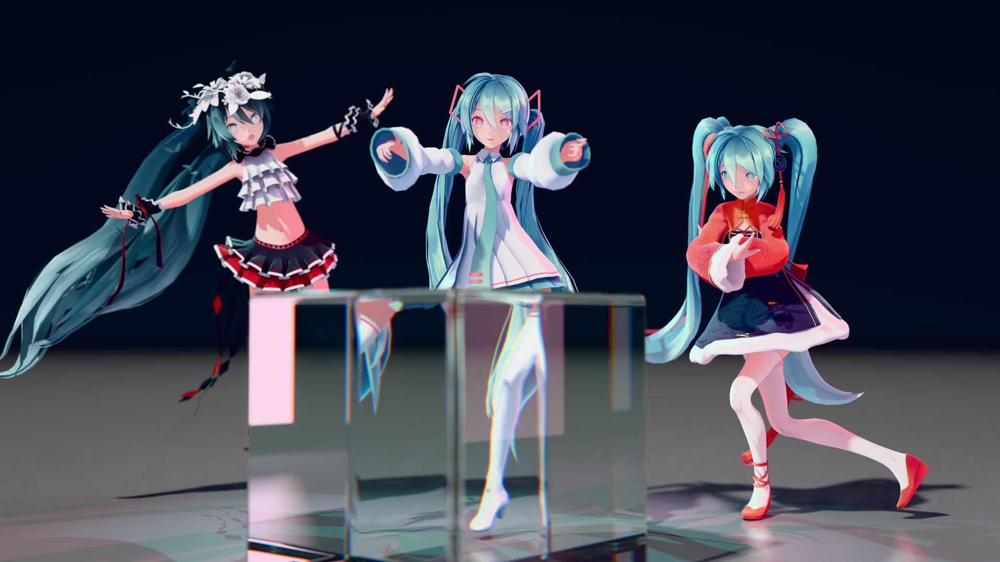
      <br><i>벤치마크 장면: 유리 큐브를 통과하며 꺾이는 빛</i>
    </td>
  </tr>
</table>

## MME 효과

수년간 MikuMikuDance용으로 모아 온 다양한 효과(.fx / .x: 블룸, 디퓨전, 컬러 그레이딩, 피사계 심도(DOF), SSAO, 거울 바닥, 불, 눈, 툰 셰이더)를 MMD나 DirectX 9 없이 DirectX 12에서 네이티브로 바로 실행할 수 있어요.


<br><sub>같은 프레임의 MME 끔 / 켬 비교 (Diffusion7 + o_LikeHDR, 서드파티 MME 효과, 동봉되지 않음).</sub>


<br><sub>적용 부위 클로즈업, 끔 | 켬: 머리카락과 소매 주변의 번짐, 드레스와 머리카락의 색감 보정, 다리 주변의 부드러운 빛과 반사.</sub>

- 포스트 이펙트(스택), 모델별 오브젝트 이펙트(모델의 자체 `.emd` 또는 같은 이름의 `.fx` 자동 인식), 이펙트 오브젝트(`.x` + `.fx`, 예: 눈, 먼지, 불).
- 래스터, 레이 트레이싱, 패스 트레이싱, 오프라인 GI, 영상 렌더에서 모두 동작하며, MMD 셀프 섀도우와 오프스크린 렌더 타깃도 지원합니다.
- 전역 스위치 하나와 "완전 자동" 워크플로(모든 모델에 어울리는 효과와 Ray-MMD 재질을 알아서 적용) 또는 "고급 수동" 선택 가능, Ray-MMD 재질용 별도 스위치 제공. 상단 내비게이션의 MME 탭, 재생 화면 우측의 "화면 효과" 패널에서 설정.
- 곡 패키지: 곡 폴더에 자체 스테이지, 무대 모션, 음원 버전, 배경/오버레이 영상을 함께 담을 수 있어요.
- 인기 효과 58종 테스트 완료: 57종 동작, 그중 42종은 MMD와 동일하게 표현 (목록: [docs/mme/compat_list.md](docs/mme/compat_list.md)).
- 저작권 문제로 효과는 기본 동봉되지 않습니다: 소장 중인 `.fx` / `.x` 파일을 원하는 위치나 라이브러리의 `effects/` 폴더에 넣어 사용하세요.

> 📖 **[MME 사용 가이드](https://mmdx.codingbot.kr/ko/docs/mme/)**

## 영상

MMDX12의 영상 모드로 노래 한 곡을 통째로 렌더해서 그대로 올렸어요.

<table>
  <tr>
    <td align="center" width="50%">
      <a href="https://youtu.be/tng53F--jEM">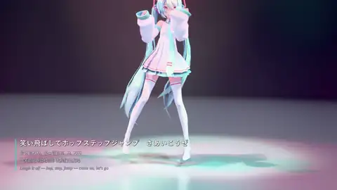</a>
      <br><b>モニタリング (Best Friend Remix)</b>
      <br><sub>패스 트레이싱 4K 60FPS</sub>
    </td>
    <td align="center" width="50%">
      <a href="https://youtu.be/WqZzpxBWhj4">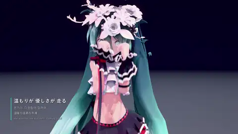</a>
      <br><b>Cute Medley: Idol Sounds</b>
      <br><sub>패스 트레이싱 QHD 60FPS</sub>
    </td>
  </tr>
  <tr>
    <td align="center" width="50%">
      <a href="https://youtu.be/6JerS9iSD50">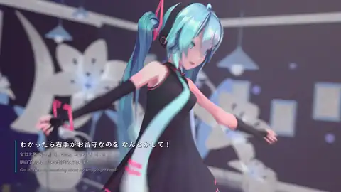</a>
      <br><b>World is Mine</b>
      <br><sub>패스 트레이싱 QHD 24FPS</sub>
    </td>
    <td align="center" width="50%">
      <a href="https://youtu.be/xYYAZFU4Yz8">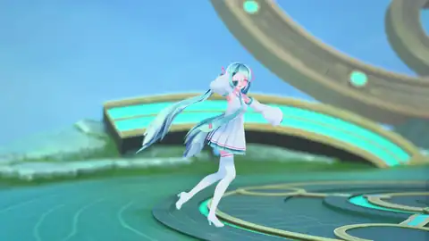</a>
      <br><b>Catch the Wave</b>
      <br><sub>패스 트레이싱 4K 60FPS</sub>
    </td>
  </tr>
</table>

## 할 수 있는 것

- **PMX, VRM, glTF, FBX.** VRoid, Mixamo, Ready Player Me 아바타도 MMD 모션으로 춤추고, glTF/FBX/OBJ 씬은 무대로 쓸 수 있어요.
- **정리는 마음대로.** `characters`, `stages`, `songs` 폴더에 나누면 확실하고, 아니어도 내용을 보고 구분해요. 틀리면 앱에서 바로잡으면 됩니다.
- **실시간 재생.** 익숙한 MMD 툰 느낌 그대로 보거나, 레이 트레이싱·패스 트레이싱을 켜서 사실적인 빛과 반사로 볼 수 있어요.
- **머리카락이랑 치마가 흔들려요.** 모델에 들어 있는 물리 설정을 그대로 씁니다.
- **진짜 재질(PBR)**: Ray-MMD용으로 만든 모델과 glTF/GLB/FBX 모델이 가진 알베도·노멀·거칠기·금속·AO·에미시브 데이터를 셰이더 탭·플레이 바·스튜디오의 **재질 데이터**에서 캐릭터·스테이지마다 켜면 래스터·레이 트레이싱·패스 트레이싱·오프라인 GI로 그려요. 애니메이션 피부와 얼굴은 매트하게 유지되고, 알아서 켜지는 일은 없어요. 2.0.0은 메이저 버전이라 켜면 일부 재질이 전과 다르게 보일 수 있어요.
- **DLSS, FSR, XeSS** 지원. 프레임이 아쉬우면 켜 보세요.
- **사진 모드**: P 키 한 번이면 4K 사진.
- **영상 모드**: 노래 한 곡을 음악까지 넣어서 MP4로, 최대 4K. 시작하기 전에 얼마나 걸릴지 미리 알려 줘요.
- **스튜디오**: MMD 스타일 키프레임 편집기로 춤을 직접 편집하고, MMD에서 열리는 표준 VMD/VPD 파일로 저장돼요.
- **DirectX 12 그래픽 카드면 충분해요.** 기본 렌더러(부드러운 그림자, 앰비언트 오클루전, 반사, 블룸)는 레이 트레이싱 GPU 없이 돌아가고, 지원하는 카드에서는 레이 트레이싱·패스 트레이싱·오프라인 GI가 켜져요.
- **끌어다 놓기.** 모델, VMD, 노래를 창에 끌어다 놓으면 스튜디오에서 포즈와 음악까지 갖춘 채로 열려요. MMD `.pmm` 프로젝트도 열 수 있어요(읽기 전용 가져오기).
- **오토루미너스 내장.** そぼろ님의 AutoLuminous용으로 설정된 재질(검은 반사색, 반사 강도 100 이상)은 MME 없이 모든 렌더러에서 스스로 빛나요.
- **MME 효과를 네이티브로.** `.fx` MikuMikuEffect 셰이더와 이펙트 오브젝트가 MMD 없이 모든 렌더러에서 실행돼요.
- **MME · Ray-MMD 탭.** MME 효과(모델 동봉 효과·후처리 스택)와 Ray-MMD 재질 데이터를 전역 스위치 하나로 켜고 끄고, 모델마다 정할 수 있어요. **완전 자동** 워크플로를 고르면 모든 모델에 알맞은 효과·재질을 알아서 적용해요. 플레이 바의 효과 버튼은 오른쪽에서 미끄러져 나오는 **화면 효과** 패널 하나를 열고, 화면 효과·셰이더·MME · Ray-MMD 세 탭으로 나뉘어요. MME 탭은 지금 불러온 모델 전체를 한 화면에서 바꾸고 `적용`을 누를 때만 반영해요 ([MME 효과](#mme-효과) 참고).
- **투명 배경 영상.** 알파가 들어간 PNG 시퀀스로 내보내서 애프터 이펙트·프리미어·다빈치에서 합성할 수 있어요.
- **스튜디오 추가 기능**: 자동 IK(손목을 끌면 팔이 따라와요), 키프레임 액세서리(위치·회전·크기·불투명도·부모 본), 머리카락·치마 물리를 일반 키로 굽기.
- **벤치마크**와 온라인 순위표. 그냥 재미로요.

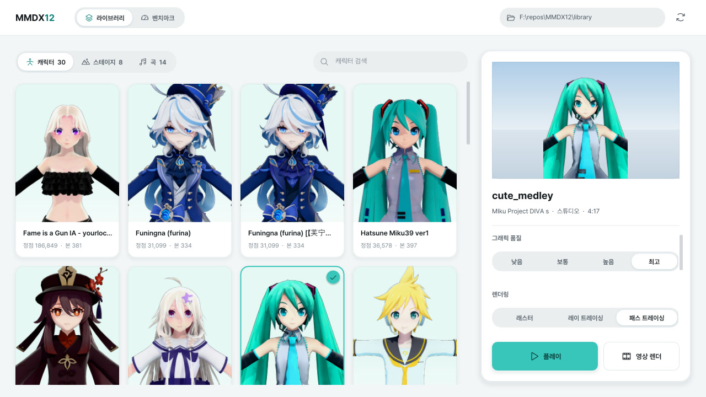
<br><sub>라이브러리 화면</sub>

## 에셋은 직접 준비해 주세요

> [!IMPORTANT]
> MMDX12에는 모델, 춤, 무대, 음악이 하나도 들어 있지 않아요. MMD 에셋은 만든 분들의 것이라 같이 배포할 수가 없거든요. 갖고 계신 걸 쓰시되, 에셋마다 정해진 규약은 꼭 지켜 주세요 (상업적 이용 금지나 영상 올릴 때 크레딧 표기 같은 것들요). 여기 나온 이미지와 영상은 제 개인 라이브러리로 만들었습니다.

`MMDX12.exe` 옆의 `library` 폴더에 넣으면 돼요 (앱에서 다른 폴더를 골라도 됩니다). 처음부터 폴더 세 개가 들어 있어요.

| 폴더 | 넣을 것 | 형식 |
|---|---|---|
| `characters/` | 모델마다 폴더 하나 (텍스처 포함) | PMX, VRM, glTF/GLB, FBX |
| `stages/` | 스테이지마다 폴더 하나 (안의 PMX는 함께 그려짐) | PMX, glTF/GLB, FBX, OBJ |
| `songs/` | 곡마다 폴더 하나: 춤 모션, 카메라 모션, 음악 | VMD, WAV/MP3/OGG/FLAC |

다르게 정리해도 괜찮아요. `models`, `motions` 같은 폴더 이름도 알아듣고, 그런 이름이 없으면 내용을 보고 짐작합니다 (사람 뼈대면 캐릭터, 큰 정적인 씬이면 스테이지, 한 폴더에 곡이 여러 개면 길이와 파일 이름으로 나눔). 잘못 짐작했으면 카드를 우클릭해서 캐릭터나 스테이지로 쓰거나 숨기면 되고, 폴더에 `mmdx.json`을 두어 직접 정할 수도 있어요 (`{"type": "song", "dance": "dance.vmd", "camera": "cam.vmd", "audio": "song.mp3"}` 처럼). PMX가 아닌 모델은 사람 뼈대(VRM, VRoid, Mixamo, Ready Player Me, Unity/Blender/UE 리그)가 있어야 하고, 불러올 때 MMD 본으로 바꿔요. 머리카락/치마 물리는 아직 없습니다.

## 시작하기

> 📖 설치부터 스튜디오까지 실제 앱 화면으로 설명한 **[사용 가이드](https://mmdx.codingbot.kr/ko/docs/)** 가 있어요.

1. [Releases](https://github.com/digital8150/MMDX12/releases/latest)에서 `MMDX12-<버전>-win64.zip`을 받아 아무 데나 압축을 풉니다.
2. `library` 폴더에 MMD 파일을 넣습니다.
3. `MMDX12.exe` 실행. 서명 안 된 실행 파일이라 처음에 SmartScreen 경고가 뜰 수 있는데, "추가 정보" → "실행"을 누르면 됩니다.

릴리즈 전에 최신 변경 사항을 써 보고 싶다면 [나이틀리 빌드](https://github.com/digital8150/MMDX12/releases/tag/nightly)를 받으세요. `master`가 바뀔 때마다 자동으로 만들어지는 빌드라 문제가 있을 수 있으니 별도 폴더에 풀어 주세요. 나이틀리에서 저장한 프로젝트는 정식 버전에서 열리지 않을 수 있습니다.

**필요한 것:** Windows 10/11, DirectX 12 그래픽카드. 레이 트레이싱, 패스 트레이싱, 고품질 렌더러는 레이 트레이싱 되는 그래픽카드(NVIDIA RTX, AMD RX 6000 이상, Intel Arc 등)가 필요하고, DLSS는 NVIDIA RTX 전용이에요.

### 조작법

| 키 | 기능 |
|---|---|
| Space | 재생 / 일시정지 |
| ← / → | 5초 앞뒤로 |
| C | 춤에 들어 있는 카메라 ↔ 자유 카메라 |
| L | 조명 바꾸기 |
| P | 4K 사진 찍기 (`사진\MMDX12`에 저장) |
| F1 | UI 숨기기 |
| 마우스 드래그 / 우클릭 드래그 / 휠 | 회전 / 이동 / 확대·축소 |
| Esc | 뒤로 |

영상은 **플레이** 옆의 **영상 렌더** 버튼으로 만들고, `동영상\MMDX12`에 저장돼요. 최고 품질로 돌리면 시간이 꽤 걸립니다. 노트북 RTX 3060 기준 4K 한 프레임에 10초쯤이라, 노래 한 곡이면 하룻밤은 넘게 걸려요. 도중에 Esc로 멈춰도 거기까지 렌더된 건 남아요.

## 스튜디오

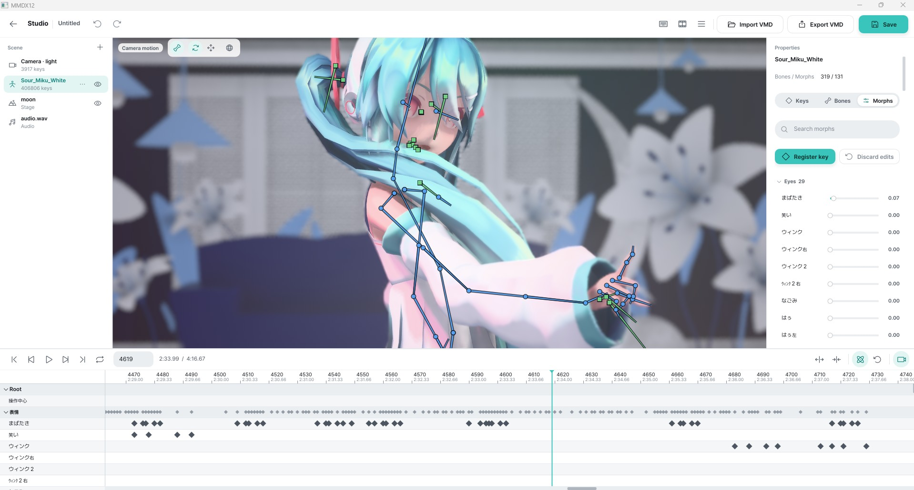

라이브러리 화면에서 아무것도 선택하지 않고 **새 스튜디오 프로젝트**를 누르면 빈 프로젝트가 열리고, 캐릭터나 곡을 고른 상태에서 **스튜디오에서 편집**을 누르면 해당 장면이 미리 채워진 상태로 시작해요. 옆의 `...` 메뉴에서는 기존 프로젝트나 최근 프로젝트를 열 수 있어요.

화면 왼쪽의 장면 목록에서 카메라, 캐릭터, 소품, 스테이지, 음원을 관리해요. `+` 버튼으로 라이브러리나 파일에서 모델(PMX, VRM, glTF, FBX)을 추가할 수 있어요. 가운데는 3D 뷰, 오른쪽은 인스펙터(키, 본, 모프 탭 및 카메라 선택 시 카메라·조명·셀프 섀도 설정), 아래쪽은 모델의 표시 프레임별로 본을 묶어 보여주는 타임라인과 베지에 보간 곡선 에디터예요.

3D 뷰에서 본을 클릭하고 회전·이동 기즈모(로컬/전역 축)로 직접 포즈를 잡을 수 있어요. IK 본을 움직이면 연결된 본들이 따라 움직여요. MMD처럼 키를 등록(`I`)하기 전까지 편집한 포즈가 유지되며, 모프 슬라이더 조절, 좌우 반전, VPD 포즈 파일 불러오기·저장도 지원해요. 타임라인에서는 키 추가·이동·삭제·복사·잘라내기·붙여넣기, 곡선만 붙여넣기, 곡선 프리셋, MMD 방식의 프레임 삽입과 삭제, 구간 선택, 음악과 함께하는 반복 재생, 물리 켜기/끄기가 돼요. 카메라, 조명, 셀프 섀도 트랙도 편집할 수 있고, "현재 시점을 키로 등록"하거나 자유 카메라 상태에서 카메라 경로를 확인할 수 있어요.

프로젝트는 `.mmdxproj` 파일로 저장되며, 모션은 옆에 MMD에서 열 수 있는 일반 VMD 파일로 함께 저장돼요. 충돌 시 복구할 수 있는 자동 저장, 음원 시작 오프셋, 소품(액세서리)을 다른 모델의 본에 붙이는 배치 기능도 있어요. 스튜디오 안에서도 라이브러리와 동일한 렌더 대화상자(래스터, 실시간 레이 트레이싱, 실시간 패스 트레이싱, 오프라인 GI)로 모션 카메라와 음악을 반영해 타임라인 구간이나 전체 프로젝트를 영상 또는 고화질 사진으로 뽑을 수 있어요. MMD와의 호환은 표준 파일(VMD, VPD)을 통해 이루어지며, MMD `.pmm` 프로젝트는 가져올 수 있어요(읽기 전용): 열면 모델, 모션, 카메라, 액세서리, 음원으로 새 스튜디오 프로젝트를 만들고, PMM에 쓰지는 않아요.

| 키 | 기능 |
|---|---|
| Space | 재생 / 일시정지 |
| ← / → | 이전 / 다음 프레임 |
| Ctrl+← / → | 이전 / 다음 키 |
| Home / End | 처음으로 / 끝으로 |
| I | 포즈 등록 (Ctrl+I: 모든 본) |
| Delete | 선택한 키 삭제 |
| Ctrl+C / X / V | 키 복사 / 잘라내기 / 붙여넣기 (Ctrl+Shift+V: 보간 곡선만) |
| Ctrl+A | 모든 키 선택 |
| Ctrl+Z / Ctrl+Y | 실행 취소 / 다시 실행 |
| E / W / L | 회전 도구 / 이동 도구 / 로컬 ↔ 전역 축 |
| Ctrl+S / Ctrl+Shift+S | 저장 / 다른 이름으로 저장 |
| Ctrl+O / Ctrl+N | 프로젝트 열기 / 새 프로젝트 |
| ? / F1 | 단축키 목록 |
| 3D 뷰 마우스 | 좌클릭 드래그: 궤도 회전(또는 기즈모 / 본 선택) · 우클릭 또는 휠 드래그: 시점 이동 · 휠: 확대/축소 |
| 타임라인 마우스 | 휠: 스크롤 · Ctrl+휠: 확대/축소 · Shift+휠: 가로 스크롤 · 눈금자 Shift+드래그: 구간 지정 |

## 벤치마크

1080p, 4K 실시간 테스트와 4K 사진 한 장을 그리는 데 걸리는 시간을 재는 시네벤치 같은 테스트가 있어요. 결과 화면에서 온라인 순위표에 올릴 수 있습니다.

에셋을 같이 줄 수가 없다 보니 벤치마크 장면도 각자 라이브러리에서 만들어요 (가장 무거운 모델과 적당한 곡을 골라서). 그래서 라이브러리가 비슷한 사람끼리만 제대로 비교가 되니까, 순위표는 재미로만 봐 주세요.

## MCP 제어

MMDX12는 [Model Context Protocol (MCP)](docs/mcp.md)을 통해 AI 어시스턴트(Claude Desktop, Cursor, Antigravity 등)로 직접 제어할 수 있습니다.
- 음악 및 안무 재생, 카메라, 씬 로드, 그래픽/렌더링 실시간 설정.
- Direct3D 12 백버퍼 스크린샷 캡처 및 에이전트 인라인 전송.
- 스튜디오(Studio) 타임라인 검사, 본(Bone) 포즈 및 조명 조정, 키프레임 편집.
- 오프라인 GI 고화질 스틸 및 영상 렌더링 자동화.

자세한 설정 방법과 35개 도구 레퍼런스는 [docs/mcp.md](docs/mcp.md)를 참고하세요.

## 소스에서 빌드하기

<details>
<summary>개발자용</summary>

Visual Studio 2026 (v18)과 Windows SDK, 그리고 CMake + Ninja(`pip install cmake ninja`)가 필요해요.

```text
build.cmd
```

결과물은 `build\bin\MMDX12.exe`예요. DLSS / FSR / XeSS 라이브러리는 따로 받아야 하고, 없으면 업스케일러만 꺼집니다.

```powershell
powershell -ExecutionPolicy Bypass -File tools/fetch_sdks.ps1
```

</details>

## 서드파티

| 의존성 | 라이선스 |
|---|---|
| [Dear ImGui](https://github.com/ocornut/imgui) | MIT |
| [stb](https://github.com/nothings/stb) | MIT / 퍼블릭 도메인 |
| [miniaudio](https://github.com/mackron/miniaudio) | MIT-0 / 퍼블릭 도메인 |
| [DirectX-Headers](https://github.com/microsoft/DirectX-Headers) | MIT |
| [nlohmann/json](https://github.com/nlohmann/json) | MIT |
| [cgltf](https://github.com/jkuhlmann/cgltf) | MIT |
| [ufbx](https://github.com/ufbx/ufbx) | MIT / Public domain |
| [Bullet Physics 3.25 subset](https://github.com/bulletphysics/bullet3) | zlib |
| [NVIDIA DLSS SDK](https://github.com/NVIDIA/DLSS) | NVIDIA RTX SDK license |
| [AMD FidelityFX SDK](https://github.com/GPUOpen-LibrariesAndSDKs/FidelityFX-SDK) | MIT |
| [Intel XeSS SDK](https://github.com/intel/xess) | Intel Simplified Software License |
| [Pretendard](https://github.com/orioncactus/pretendard) | SIL OFL 1.1 |
| [Phosphor Icons](https://github.com/phosphor-icons/core) | MIT |

*"MikuMikuDance"는 樋口優(Yu Higuchi) 님이 만들었고, 하츠네 미쿠는 Crypton Future Media의 캐릭터입니다. MMDX12는 비공식 팬 프로젝트이고 두 곳과 아무 관련이 없어요.*

## 후원

MMDX12가 마음에 드셨다면 비트코인으로 커피 한 잔 사 주세요:

<p>
  <a href="https://pay.digitalism.site/api/v1/invoices?storeId=63rqo9gJMgSoEn8N59SfUmBLrU6KFeLrXVAxtJQh6fgT&price=5000&currency=KRW"></a>
  <a href="https://pay.digitalism.site/api/v1/invoices?storeId=63rqo9gJMgSoEn8N59SfUmBLrU6KFeLrXVAxtJQh6fgT&price=10000&currency=KRW"></a>
  <a href="https://pay.digitalism.site/api/v1/invoices?storeId=63rqo9gJMgSoEn8N59SfUmBLrU6KFeLrXVAxtJQh6fgT&price=30000&currency=KRW"></a>
</p>

## 라이선스

MMDX12 코드는 [MIT](LICENSE)예요. 서드파티 코드는 각자의 라이선스를 따르고, MMD 에셋은 해당 없습니다.

## 다음에 할 것

- 재질 모프, SDEF 스키닝, PMD 모델, 플레이 화면의 VMD 조명 트랙.
- 라이브러리 로딩 더 빠르게.
- 스튜디오 후속: 예전 PMM(0001) 파일, PMM 가져오기 때 더 많은 MME 효과 대응.
